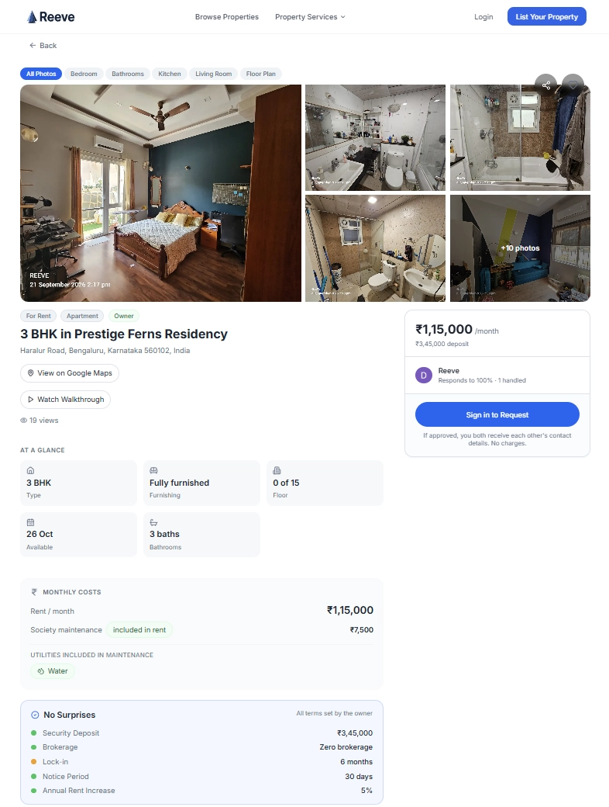
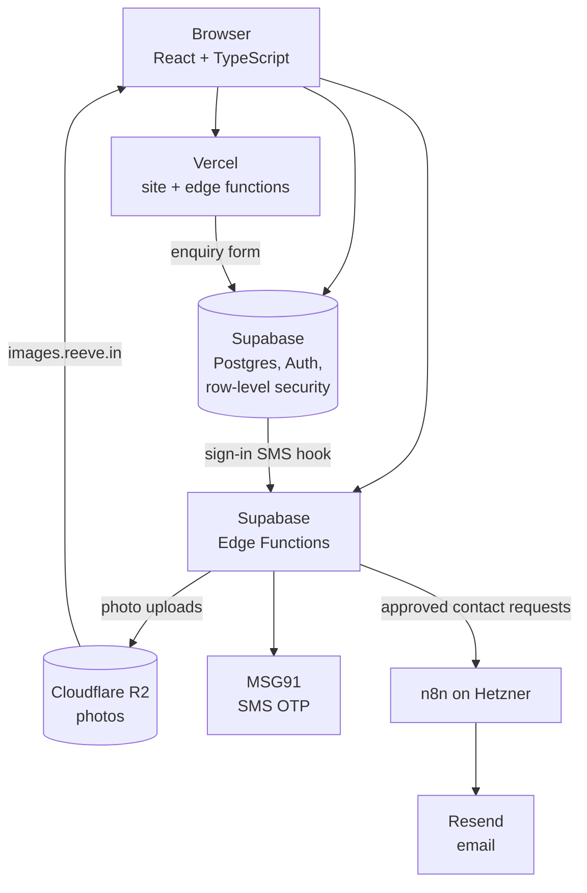

# Reeve

Reeve is a free property marketplace for India that connects owners with tenants, and sellers with buyers. Contact requests are private: an owner's phone and email stay hidden until the owner approves.

The site is live at [www.reeve.in](https://www.reeve.in).

[Live site](https://www.reeve.in) · [Build log](log.md) · [Claude Code rules](CLAUDE.md)

Want to try the owner and tenant flows yourself? Email [lohit@reeve.in](mailto:lohit@reeve.in) for test accounts with sample listings.



## How I built it

- **Plans:** I chose the stack, planned every feature and wrote the plan documents.
- **Prompts:** I worked in phases of numbered prompts — diagnose → plan → implement → verify — drafted with my own prompt-drafting skill ([an earlier version is in the repo](.claude/skills/code-prompt-drafter-v2)). Every AI chat started with the project's context files: `CLAUDE.md`, `log.md`, `package.json`, `App.tsx` and the relevant plan.
- **Review:** for each feature, Claude Code made a plan in plan mode; a second AI (ChatGPT) reviewed it before implementation, and the final diff was checked again.
- **Code:** Claude Code wrote the code, tests and database migrations, following [`CLAUDE.md`](CLAUDE.md) and the skills and commands in [`.claude/`](.claude). I deployed the database changes myself.
- **Security:** in September 2026 I ran a security review of the whole repo with Claude (Fable 5.1), then ran it again to check. Thirteen problems were fixed between 9 and 12 September (see `log.md`).

## What it does

Each feature answers a common problem on Indian property sites: paid access to owners' contact details, stale listings, brokers posing as owners, and hidden costs.

- **Listing:** owners list their own property, with photos, a map pin and the full cost up front: deposit, move-in charges and notice period. An admin reviews new listings, and edits to key details, before they go live.
- **Search:** rent or buy, by place. Brokers can list but must say so: each result shows whether the lister is the owner or a broker, and any brokerage.
- **Private contact requests:** a seeker sends a short request; the owner's details are revealed by email only if the owner approves.
- **Fresh listings:** rentals must be reconfirmed every 30 days (sales every 60) or they're unlisted, and each listing shows a public timeline.
- **Trust:** a moderated public Q&A on every listing, and two-way ratings only after an approved contact.
- **Services and admin:** paid property-service pages with an enquiry form; admin tools for review, moderation, callbacks and PDF inspection reports.

## How the product changed

Reeve began in March 2026 as a fully managed rental service for Bangalore, funded by a 7% fee that tenants would have paid with their rent. In a pilot, none of the at least 20 tenants offered that model accepted it — they preferred a one-time brokerage — so in July 2026 Reeve was split into this free marketplace and separate paid property services.

## Architecture

- **Front end:** React 18 and TypeScript (Vite), Tailwind and shadcn/ui; public pages are pre-rendered at build, for speed.
- **Hosting:** Vercel, with edge functions for property-page tags, sitemaps and the enquiry form. I found it easier to set up than Cloudflare.
- **Data and sign-in:** Supabase — Postgres with PostGIS, Auth, row-level security and 11 Edge Functions.
- **Photos:** Cloudflare R2, for more free storage; it holds only public images.
- **SMS:** MSG91, because SMS OTPs in India need DLT registration.
- **Email and automation:** n8n, self-hosted on Hetzner, sending through Resend; chosen over Make.com on cost and flexibility.
- **Also:** Google Maps (Places), Cloudflare Turnstile, Sentry, PostHog and react-pdf.



## Security and privacy

- **No passwords:** sign-in is by phone OTP or Google (PKCE). OTP sends are limited to 5 an hour per phone number and per IP address, logs never hold OTP codes or full phone numbers, and a new account can only get the ordinary user role.
- **Keys:** row-level security on the database tables. Server keys aren't in the repo; Supabase and Vercel hold them. The committed `.env` holds only values that ship in the site's JavaScript anyway: the Supabase URL and anon key, the Sentry DSN and the image host.
- **Contact details** are revealed only after the owner approves, and phone numbers never appear in server responses.
- **Photos** lose their location and camera data (EXIF) before upload. Sentry and PostHog run only in production, identify users by ID only, and mask text and inputs in their replays.

## What's in the repo

Numbers as of 22 September 2026: 1,318 commits, 313 merged pull requests, 37 routes, 43 database migrations and 11 Supabase Edge Functions.

- [`CLAUDE.md`](CLAUDE.md) — the project rules Claude Code followed.
- [`log.md`](log.md) — the build log: 553 dated entries, April–September 2026.
- [`.claude/`](.claude) — the Claude Code skills and commands I used, and a permissions file that blocks risky commands and reading `.env` files.
- [`supabase/`](supabase) — migrations (a fresh baseline on 21 August 2026), Edge Functions and SQL tests. [`src/`](src) holds the app and its tests; [`api/`](api), the Vercel edge functions.
- [The marketplace's decision log](https://github.com/serialmakers1/Reeve/blob/a03018a1f6991231b26675899f6db6f797ab3293/commons-decisions.md) — Claude Code's working notes for the July–August 2026 rebuild: 177 numbered decisions with their reasons (removed on 21 August 2026; still in the history).

## Running it locally

<details>
<summary>Commands, and what a full setup needs</summary>

Needs Node.js 20.19+ or 22.12+ (Vite 7).

```sh
npm ci
npm run dev     # http://localhost:8080
npm test        # Vitest
npm run build   # production build, then the sitemap and pre-rendering
```

The committed `.env` points the app at the live Supabase project, with the same public (anon) access as the website. Running your own backend needs a Supabase project with the migrations applied and the Edge Functions deployed. Variable names only — never commit their values:

- Edge Function secrets: `SEND_SMS_HOOK_SECRET`, `MSG91_AUTH_KEY`, `MSG91_TEMPLATE_ID`, `R2_ACCESS_KEY_ID`, `R2_SECRET_ACCESS_KEY`, `N8N_WEBHOOK_SECRET`, `RESEND_WEBHOOK_SECRET`, `GOOGLE_MAPS_SERVER_KEY` (Supabase provides `SUPABASE_URL`, `SUPABASE_ANON_KEY` and `SUPABASE_SERVICE_ROLE_KEY`).
- Vercel: `SUPABASE_URL`, `SUPABASE_PUBLISHABLE_KEY`, `SUPABASE_SECRET_KEY`, `TURNSTILE_SECRET_KEY`, `N8N_WEBHOOK_BASE_URL`, `N8N_WEBHOOK_SECRET`; and, for the browser, `VITE_GOOGLE_MAPS_API_KEY`, `VITE_GOOGLE_MAPS_MAP_ID`, `VITE_TURNSTILE_SITE_KEY`, `VITE_POSTHOG_KEY`, `VITE_POSTHOG_HOST`.

</details>

## Licence

No open-source licence. © 2026 Reeve. All rights reserved. You're welcome to read, clone and run this code to evaluate it; any other use needs written permission. Third-party libraries keep their own licences ([notice](public/third-party-licenses.txt)).

## Contact

[lohit@reeve.in](mailto:lohit@reeve.in)
